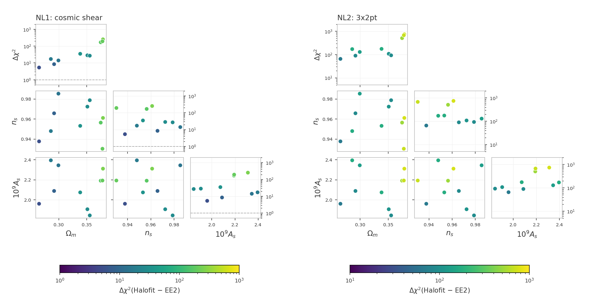
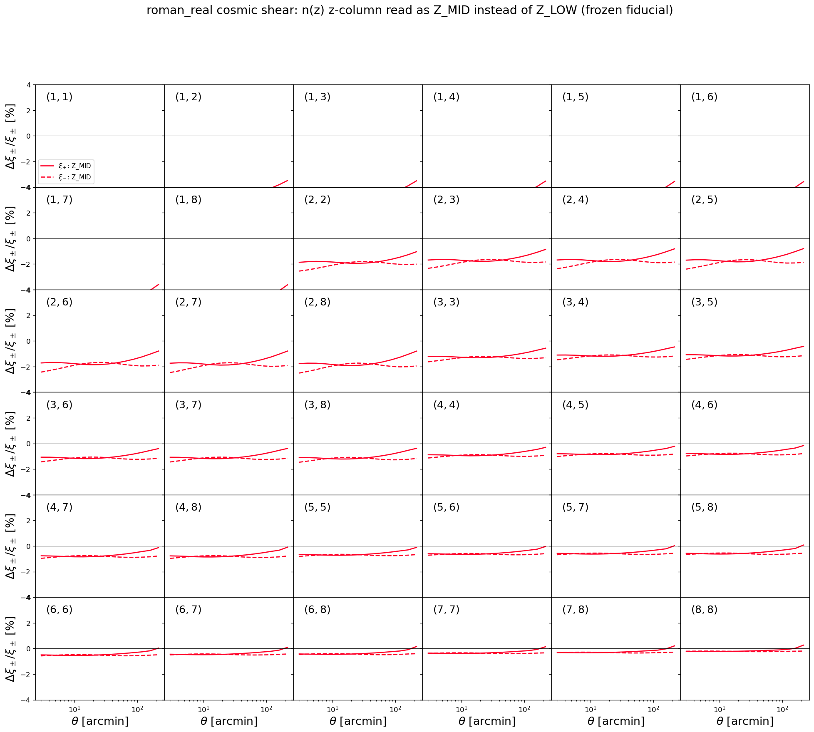

# Unit tests for the likelihoods

These tests catch two kinds of silent breakage: a $\chi^2$ that drifted
because code or data changed by accident, and a race condition (a bug
where evaluating several points in a row corrupts a later result
through leftover internal state or colliding OpenMP threads).

Every model build runs in its own worker subprocess. In this project
both examples share one data set, so the isolation is preventive: it
keeps the tests immune to the process abort that different data-set
dimensions trigger inside cosmolike, and every project keeps one
architecture. The commands below stay the
same.

# Table of contents

1. [Running the tests](#run_tests)
2. [The tests](#the_tests)
    1. [The CFASTPT vs FASTPT comparison](#cfastpt_fastpt)
    2. [The Halofit vs EE2 checks](#halofit_ee2)
    3. [The EE2 race test](#ee2_race)
    4. [Scale-cut diagnostics](#scale_cut_diagnostics)
    5. [Accuracy checks](#accuracy_checks)
    6. [Baryonic feedback accuracy checks](#baryon_accuracy_checks)
    7. [Baryonic feedback drift tests](#baryon_drift_tests)
    8. [The photo-z convention checks](#photoz_conventions)
    9. [The non-Limber galaxy-galaxy lensing check](#nonlimber_ggl)
    10. [The non-Limber galaxy clustering check](#nonlimber_gg)
    11. [The sector-ladder cache check](#cache_ladder)
    12. [The halo-model checks](#halo_checks)
3. [Appendix](#appendix)
    1. [FAQ: Do the tests keep their own data?](#frozen_copy)
    2. [FAQ: Why do the TATT tests use their own data vector?](#synthetic_vectors)
    3. [FAQ: Why were the references refrozen on 2026-09-28?](#gg_growth_fix)
    4. [FAQ: How can maintainers refresh the snapshot?](#refreeze)

## Running the tests 

We assume users are in the Conda cocoa environment from a previous
`conda activate cocoa` command, that the shell is bash, and that the
current folder is the cocoa main folder `cocoa/Cocoa`.

**Step :one:**: activate the private Python environment by sourcing
the script `start_cocoa.sh`

    source start_cocoa.sh

**Step :two:**: run the tests of this project

    python -m pytest ./projects/roman_real/tests/data_vector

Without pytest:

    python -m unittest discover -s ./projects/roman_real/tests -v

The tests change no project files. Each test prints a progress line
per model build and per evaluation, then a report with the
computed $\chi^2$, the stored reference, the difference, and the pass
limit.

A full run performs about 135 likelihood evaluations and takes a
few minutes. The test files force `OMP_NUM_THREADS=4` internally.

## The tests 

The standard configurations get four tests each: a $\chi^2$ drift check
and a race-condition check, both in the NLA and in the TATT intrinsic-alignment
model. The TATT variants set

    IA_model: 1
    roman_A2_1: 0.05
    roman_BTA_1: 0.05
    roman_A2_2: -1.51541

The two checks and their pass limits:

| check | pass limit                                        | a failure means                    |
|-------|---------------------------------------------------|------------------------------------|
| $\Delta\chi^2$ | the recomputed $\chi^2$ must stay within 0.2 of the value stored in `frozen/reference_chi2.json` | code or data changed the numbers |
| race condition | the fiducial evaluated on its own vs evaluated again after nine other cosmologies; the two must agree within $10^{-4}$ | leftover state or an OpenMP race |

Everything the tests compare against lives under `frozen/`: one
snapshot of configurations, data, and reference values, captured
together when the references were generated and unchanged since. The
[Appendix](#appendix) explains how the snapshot is protected.

The test files and the configurations they cover:

| test | file | configuration | what it checks |
|---|---|---|---|
| 1 | `test_example1.py` | cosmic shear; IA modeling: NLA | $\Delta\chi^2$ against the stored reference at the fiducial point |
| 2 | `test_example1.py` | cosmic shear; IA modeling: NLA | race condition (OpenMP threading): fiducial alone vs after nine other cosmologies |
| 3 | `test_example1.py` | cosmic shear; IA modeling: TATT | $\Delta\chi^2$ against the stored reference at the fiducial point |
| 4 | `test_example1.py` | cosmic shear; IA modeling: TATT | race condition (OpenMP threading): fiducial alone vs after nine other cosmologies |
| 5 | `test_example2.py` | 3x2pt; IA modeling: NLA | $\Delta\chi^2$ against the stored reference at the fiducial point |
| 6 | `test_example2.py` | 3x2pt; IA modeling: NLA | race condition (OpenMP threading): fiducial alone vs after nine other cosmologies |
| 7 | `test_example2.py` | 3x2pt; IA modeling: TATT | $\Delta\chi^2$ against the stored reference at the fiducial point |
| 8 | `test_example2.py` | 3x2pt; IA modeling: TATT | race condition (OpenMP threading): fiducial alone vs after nine other cosmologies |
| 11 | `test_example2_2x2pt.py` | 2x2pt (`roman_real.combo_2x2pt`: the 3x2pt configuration reduced to galaxy clustering plus galaxy-galaxy lensing); IA modeling: NLA | $\Delta\chi^2$ against the stored reference at the fiducial point |
| 12 | `test_example2_2x2pt.py` | 2x2pt (`roman_real.combo_2x2pt`: the 3x2pt configuration reduced to galaxy clustering plus galaxy-galaxy lensing); IA modeling: NLA | race condition (OpenMP threading): fiducial alone vs after nine other cosmologies |
| 13 | `test_example2_2x2pt.py` | 2x2pt (`roman_real.combo_2x2pt`: the 3x2pt configuration reduced to galaxy clustering plus galaxy-galaxy lensing); IA modeling: TATT | $\Delta\chi^2$ against the stored reference at the fiducial point |
| 14 | `test_example2_2x2pt.py` | 2x2pt (`roman_real.combo_2x2pt`: the 3x2pt configuration reduced to galaxy clustering plus galaxy-galaxy lensing); IA modeling: TATT | race condition (OpenMP threading): fiducial alone vs after nine other cosmologies |
| 15 | `test_notebook_interface.py` | the notebook-style direct interface: EXAMPLE_EVALUATE1.ipynb's call sequence (its own CAMB run, `set_cosmology`, `compute_data_vector_masked`, no cobaya) on the frozen cosmic-shear dataset and point | $\Delta\chi^2$ against the stored cobaya reference, within 0.2 |
| 16 | `test_fastpt.py` | cosmic shear; IA modeling: TATT; the C cfastpt (`IA_code: 0`) vs the python FAST-PT package (`IA_code: 1`) at 30 fixed points (20 across the intrinsic-alignment prior plus a one-parameter-at-a-time family), cosmology at the fiducial | $\Delta\chi^2$ of the FAST-PT data vector against the cfastpt data vector at the same point; the cfastpt vector is that point's fiducial, so agreement means zero |
| 17 | `test_fastpt.py` | 3x2pt; IA modeling: TATT; the same comparison as test 16 on the 3x2pt likelihood (`roman_real.combo_3x2pt`) | the same pass rule as test 16, with the data-vector difference weighted by the 3x2pt masked inverse covariance |
| 18 | `test_fastpt.py` | 2x2pt; IA modeling: TATT; the same comparison as test 16 on the 2x2pt likelihood (`roman_real.combo_2x2pt`) | the same pass rule as test 16; clustering carries no intrinsic alignment, so the TATT tables enter through galaxy-galaxy lensing alone, weighted by the 2x2pt masked inverse covariance |
| 19 | `test_ee2.py` | cosmic shear; NLA with EE2 (`non_linear_emul: 1`) | race condition (OpenMP threading, including EE2's own threaded compute): fiducial alone vs after nine other cosmologies |
| 20 | `test_halo_ia_race.py` | 3x2pt with Limber galaxy-galaxy lensing; IA modeling: halo model (`include_halo_IA: 1`, Fortuna et al. 2021) | race condition (OpenMP threading): the fiducial evaluated ten times on one model, the halo-model IA tables refilled before each evaluation, every result bitwise identical; runs only with `COCOA_HALO_SLOW=1` |
| 21 | `test_halo_ia_race.py` | 3x2pt with Limber galaxy-galaxy lensing; IA modeling: halo model (`include_halo_IA: 1`, Fortuna et al. 2021) | thread count: the fiducial evaluated in fresh processes with 1, 4 and 8 OpenMP threads, every result bitwise identical; runs only with `COCOA_HALO_SLOW=1` |

### The CFASTPT vs FASTPT comparison (`test_fastpt.py`, tests 16-18) 

Cosmolike computes the TATT perturbation-theory integrals with two
implementations: cfastpt, the C code built into the interface
(`IA_code: 0`), and the python FAST-PT package through the fastpt
theory block (`IA_code: 1`). Both are evaluated at 30 fixed points
across the intrinsic-alignment prior and checked for agreement:
test 16 on cosmic shear, test 17 on the 3x2pt likelihood, test 18
on the 2x2pt likelihood.

At every point the cfastpt data vector is the fiducial: the reported
quantity is the $\Delta\chi^2$ of the FAST-PT vector against it,
zero for identical vectors and quadratic in their difference. A
comparison against the shipped data vector would measure the slope
of the distance to the data instead of the numerics.

The fastpt block computes on two grids: `accuracyboost` multiplies
the density of the output table cosmolike reads with linear
interpolation (the accuracy driver), and `internal_accuracyboost`
the density of the internal grid the FFTLog convolutions run on,
with a cubic spline in log k upsampling the terms from one grid
onto the other.

Both boosts are rebased so 1.0 is the converged configuration. The
tests run FAST-PT at the defaults with the 0.2 band of the other
checks as the pass limit; a doubled configuration repeats the
measurement as an advisory.

In test 17 the TATT terms also enter galaxy-galaxy lensing, and the
difference is weighted by the 3x2pt masked inverse covariance. The
frozen configuration fixes the one-loop bias amplitudes
(`roman_B2_*`) at zero, so the one-loop galaxy-bias tables both
implementations compute multiply by zero: the sweep scores the
intrinsic-alignment tables alone, on the wider data vector.

Test 18 repeats the sweep on the 2x2pt likelihood. Clustering
carries no intrinsic alignment, so there the TATT tables are scored
through galaxy-galaxy lensing alone, under the 2x2pt masked
inverse covariance.

> [!NOTE]
> Before the two-grid upgrade of the fastpt theory block (2026-09)
> there was no upsampling and the difference reached
> $\Delta\chi^2 = 2248$ across the prior.

The point values, the design, and the decision record live with the
lsst_y1 project (its tests/README.md carries the full discussion);
the table below is this project's own measurement:

| output table (points) | internal grid (points) | max $\Delta\chi^2$ | cost per cosmology |
|---|---|---|---|
| 1,100 | 1,100 (shared) | 2248 | 1.2 s |
| 128,900 | 1,100 | 0.187 | 1.2 s |
| 1,024,900 (`accuracyboost: 1`, the default) | 1,100 (the default) | 0.0194 | 1.5 s |
| 2,048,900 (`accuracyboost: 2`) | 1,300 (`internal_accuracyboost: 2`) | 0.0171 | 1.8 s |

Measured on 2026-09-23:

- Test 17 (3x2pt): max $\Delta\chi^2 = 0.027$ at the defaults,
  $0.010$ at the pushed camb/cosmolike settings.
- Test 18 (2x2pt): $0.00031$ and $0.00015$, the mildest of the
  three, with the TATT tables entering through galaxy-galaxy
  lensing alone.
- `--mask=ones` (no scale cuts, all 2,115 points weighted): cosmic
  shear repeats its frozen-mask numbers digit for digit - the
  frozen `example1.mask` keeps all 1,080 cosmic-shear points, so
  the two masks agree on that section - and measures max
  $\Delta\chi^2 = 0.0076$ at the pushed settings; 2x2pt measures
  $0.0012$ at the defaults and $0.00057$ pushed.

> [!Warning]
> The 3x2pt sweep does not run under `--mask=ones`: cosmolike stops
> at `IP::set_inv_cov: masked cov not positive definite`. The shipped covariance is positive definite only under
> the frozen scale cuts - on the full 2,115-point vector its
> smallest eigenvalue is negative - so there is no all-ones 3x2pt
> measurement.

> [!NOTE]
> The fastpt defaults hold this accuracy on their own; raising the
> boosts is a convergence test, not a need. cfastpt (`IA_code: 0`)
> remains the reference implementation.

#### Running the comparison 

We assume users are in the Conda cocoa environment from a previous
`conda activate cocoa` command, that the shell is bash, and that the
current folder is the cocoa main folder `cocoa/Cocoa`.

**Step :one:**: activate the private Python environment by sourcing
the script `start_cocoa.sh`

    source start_cocoa.sh

**Step :two:**: run the comparison at the default camb/cosmolike
settings

    python -m pytest ./projects/roman_real/tests/data_vector/test_fastpt.py

**Step :three:**: repeat it at the pushed camb/cosmolike settings

    python -m pytest ./projects/roman_real/tests/data_vector/test_fastpt.py --high=1

> [!NOTE]
> `--high=1`: applies the pushed camb/cosmolike settings of the
> accuracy checks to every block of tests 16-18 (the other tests do
> not read it). The full comparison is both invocations.

> [!NOTE]
> `--mask`: reruns tests 16-18 under a different scale-cut mask.
> `--mask=frozen` (the default) keeps the frozen contract's
> `example1.mask` scale cuts (1,950 of the 2,115 data points);
> `--mask=ones` keeps every point (no scale cuts), the strictest
> comparison. Each choice is a frozen TATT dataset variant
> differing only in its `mask_file` line, and the 0.2 pass rule
> applies unchanged.

Test 15 exists because a changed interface binding (init_IA growing
`ia_code`) or a grid rejected by the C layer breaks every notebook
while the yaml pipeline keeps passing.

### The Halofit vs EE2 checks (`test_nonlinear.py`, NL1-NL2) 

The likelihood can source the nonlinear matter power from CAMB's
Takahashi halofit (`non_linear_emul: 2`, the frozen contract's
setting) or from EuclidEmulator2 (`non_linear_emul: 1`). Check NL1
evaluates the cosmic-shear data vector with both at ten fixed
cosmologies across the omegam/ns/As space (every other parameter at
the frozen fiducial) and reports, per cosmology, the
$\Delta\chi^2$ of the Halofit vector against the EE2 vector; check
NL2 repeats the sweep on the 3x2pt likelihood.

The EE2 vector is that cosmology's fiducial, so the baseline is
zero by construction and no stored data vector enters the metric.
The checks are advisory - there is no pass limit: the numbers say
how much of the statistical error budget the Halofit-vs-emulator
difference consumes under the chosen scale cuts, the question "can
Halofit be used on real data analysis at this mask". The `--mask`
option of the comparison sweeps applies.

Measured on 2026-09-23 (the figure below, frozen mask):

- NL1 (cosmic shear): per-cosmology $\Delta\chi^2$ between 5.4 and
  253.7 (median 27.7), largest at the high-omegam draws; repeats
  its frozen-mask numbers digit for digit under `--mask=ones` - the
  frozen `example1.mask` keeps all 1,080 cosmic-shear points, so
  the two masks agree on that section.
- NL2 (3x2pt): between 65.1 and 743.3 (median 150.1); does not run
  under `--mask=ones` - cosmolike stops at
  `IP::set_inv_cov: masked cov not positive definite`, the all-ones
  covariance limitation the Warning above records for the 3x2pt
  CFASTPT sweep.
- At these ten cosmologies the two nonlinear-P(k) sources are not
  interchangeable at this project's precision, even under the
  frozen scale cuts.

#### Running the Halofit vs EE2 checks 

We assume users are in the Conda cocoa environment from a previous
`conda activate cocoa` command, that the shell is bash, and that the
current folder is the cocoa main folder `cocoa/Cocoa`.

**Step :one:**: activate the private Python environment by sourcing
the script `start_cocoa.sh`

    source start_cocoa.sh

**Step :two:**: run the checks on their own

    python -m pytest ./projects/roman_real/tests/data_vector/test_nonlinear.py

### The EE2 race test (`test_ee2.py`, test 19) 

Cocoa pins a modified EuclidEmulator2: OpenMP threading, a
1,010-redshift capacity, the `get_boost2` API with a pre-built
emulator, memory-leak fixes, and a bilinear interpolation with a
border fix. The modifications and their measured speed-up are
documented in the repository's own README
(`external_modules/code/euclidemu2/README.md`).

Test 19 is the race check with EE2 on: the fiducial evaluated fresh
and again as the 10th of 10 cosmologies on one model instance, with
the nonlinear $P(k)$ from EE2 (`non_linear_emul: 1`). EE2's compute
is OpenMP-threaded, so a thread race inside it shifts the second
fiducial value; the two must agree within $10^{-4}$.

Measured on 2026-09-23:

- Test 19: the fresh and 10th-in-a-row fiducial agree to all eight
  printed decimals.
- The modified build against the pre-modification one, at ten
  cosmologies on this project's cosmic shear under its frozen mask:
  max $\Delta\chi^2 = 7.2\times10^{-5}$, max fractional data-vector
  difference $3.9\times10^{-5}$. The modification gate that compiles
  the pre-modification build at test time runs as test 18 of the
  lsst_y1 project (its `tests/test_ee2.py`).

### Scale-cut diagnostics (`test_scale_cut_diagnostics.py`) 

The scale-cut diagnostics of 2011.06469 eq 17 — dlnC_ss/dlnk,
dlnxi_pm/dlnk, and the response functions rf_C_ss and rf_xi — are
notebook-facing functions with no role in the likelihood, so this
test is their only automated coverage. It checks, in one process on
the frozen TATT cosmic-shear fiducial, that every scalar and array
overload returns finite values, that the scalar overloads agree with
the matching array entries (they share the batch engines), and that
the response functions behave as normalized cumulative fractions.

The checked multipoles include $`\ell = 3`$ and 10. At $`\ell \le 20`$ an
exact scalar evaluation would underflow $`k`$ to zero in the
normalization integrand, where the C layer exits and takes a Jupyter
kernel with it; the test requires finite values there.

### Accuracy checks (`test_accuracy.py`, A1-A6) 

We change one accuracy parameter at a time on the 3x2pt NLA
configuration (each parameter's $\Delta\chi^2$ prints as a `KNOB`
line, the label the test output uses; the scan also stresses
`accuracyboost: 5` on its own). Then checks A1-A6 re-evaluate
cosmic shear, 3x2pt, and 2x2pt, with NLA and TATT, with every
setting raised at once:

| setting | raised to | what it controls |
|---------|-----------|------------------|
| `accuracyboost` (cosmolike) | 3 | sizes of cosmolike's internal lookup tables, including the dyadic z grid of the power-spectrum tables |
| `integration_accuracy` (cosmolike) | 10 | extra refinement passes of cosmolike's numerical integrals |
| `internal_accuracyboost` (cosmolike) | 2 | density of the C-FAST-PT convolution grid relative to the output table the likelihood interpolates; 1 is the legacy single-grid path |
| `lmax` (cosmolike) | 200000 | highest multipole of the internal harmonic-space $C_\ell$ tables that cosmolike transforms into the real-space correlation functions; arcminute scales need very high $\ell$ |
| `kmax_boltzmann` (cosmolike) | 40 | the k cutoff of the power spectrum the likelihood requests from CAMB |
| `AccuracyBoost` (CAMB) | 2 | CAMB's overall accuracy multiplier: denser sampling in every internal CAMB grid, the most expensive setting |
| `k_per_logint` (CAMB) | 50 | k samples CAMB computes per logarithmic interval of the transfer functions |
| `kmax` (CAMB) | 50 | highest k of CAMB's matter power spectrum; one physical cutoff with `kmax_boltzmann`, seen from the CAMB side |

`accuracyboost` refines a nested z grid in the power-spectrum
tables: every coarser grid's nodes are a subset of every finer
grid's, so a higher boost tightens the same interpolation instead of
moving the nodes (the construction is commented in
`likelihood/_cosmolike_prototype_base.py`).

`internal_accuracyboost` scales only the C-FAST-PT convolution
grid; the output table the likelihood interpolates is unchanged.
The likelihood yamls set `internal_accuracyboost: 1`, which keeps the
convolution grid equal to the output table: the exact single-grid
path. Coarser grids also hold: the lsst_y1 scan of this setting
measured $`\Delta^T C^{-1} \Delta \le 10^{-9}`$ against the single-grid
path down to `internal_accuracyboost: 0.27`.

When several settings move the $\chi^2$, settle them in cost order:
raise cosmolike `accuracyboost` first (cheap), then CAMB
`k_per_logint`, and CAMB `AccuracyBoost` last (expensive at run
time, and able to masquerade for the cheap settings).
`kmax_boltzmann` and CAMB `kmax` are one physical cutoff seen from
two sides; move them together.

Each check reports the $\Delta\chi^2$ between the high-accuracy and
the default evaluations: the numerical error of the default
settings. No pass/fail.

> [!NOTE]
> High-accuracy evaluations take minutes.

#### Running Accuracy checks 

We assume users are in the Conda cocoa environment from a previous
`conda activate cocoa` command, that the shell is bash, and that the
current folder is the cocoa main folder `cocoa/Cocoa`.

**Step :one:**: activate the private Python environment by sourcing
the script `start_cocoa.sh`

    source start_cocoa.sh

**Step :two:**: run the accuracy checks on their own

    python -m pytest ./projects/roman_real/tests/data_vector/test_accuracy.py

To run every other test while skipping these:

    python -m pytest ./projects/roman_real/tests --ignore ./projects/roman_real/tests/data_vector/test_accuracy.py

### Baryonic feedback accuracy checks (`test_accuracy_baryons.py`, BF1-BF7) 

The file `test_accuracy_baryons.py` repeats the default-versus-high
accuracy comparison with the `bfmt` theory block switched on: one
advisory check per feedback method (the three SP(k) fb relations,
BCEmu, Flamingo, BACCOemu, and BCemu2025), at a fixed parameter
point per method.

Each check creates its data vector on the fly: the default-settings
model writes its own theory vector during evaluation, that vector becomes
the data of a temporary dataset, and the pushed-settings model
evaluates at the same point against it. The fiducial $\chi^2$ is
therefore zero by construction, nothing is stored in the snapshot,
and the single reported number, $\Delta\chi^2$, is a pure numerics
response.

The check BF0 additionally runs the one-setting-at-a-time scan
with the Akino SP(k) feedback on, so a large delta names the
setting causing it.

Every checked configuration is measurable by construction. The
BACCOemu check evaluates with `omegab: 0.049`, inside that
emulator's baryon-density training box, whose floor sits exactly
above the fiducial `omegab: 0.04`; and the double-power-law point is
chosen to keep the baryon fraction inside SP(k)'s calibrated band
over the full redshift grid.

#### Running the baryonic feedback checks 

We assume users are in the Conda cocoa environment from a previous
`conda activate cocoa` command, that the shell is bash, and that the
current folder is the cocoa main folder `cocoa/Cocoa`.

**Step :one:**: activate the private Python environment by sourcing
the script `start_cocoa.sh`

    source start_cocoa.sh

**Step :two:**: run the baryonic feedback checks of this project

    python -m pytest ./projects/roman_real/tests/data_vector/test_accuracy_baryons.py

### Baryonic feedback drift tests (`test_baryons.py`, BD1-BD7) 

The file `test_baryons.py` pins the feedback pipeline against change
over time, one test per method.

Each method's default-settings theory prediction was stored at
freeze time (`generate_frozen_reference.py --baryons`), and the
test evaluates today's prediction against that stored vector: zero
at freeze time by construction, so a $\chi^2$ above the tolerance
means cosmolike or the `bfmt` theory block changed its prediction
since the freeze.

These tests complement the accuracy checks above: the accuracy
checks regenerate their vector on the fly per run, so they measure
the numerical settings and can never see drift; the drift tests hold
the frozen vector still, so they measure drift and nothing else.

#### Running the baryonic feedback drift tests 

We assume users are in the Conda cocoa environment from a previous
`conda activate cocoa` command, that the shell is bash, and that the
current folder is the cocoa main folder `cocoa/Cocoa`.

**Step :one:**: activate the private Python environment by sourcing
the script `start_cocoa.sh`

    source start_cocoa.sh

**Step :two:**: run the drift tests of this project

    python -m pytest ./projects/roman_real/tests/data_vector/test_baryons.py

### The photo-z convention checks (`test_photoz_conventions.py`) 

The likelihood exposes two runtime knobs for how the n(z) table files
become the smooth distributions the Limber integrals consume, both
declared in the likelihood yamls and both defaulting to the
historical behavior: `photoz_interpolation_type` (0 = cubic spline,
1 = linear, 2+ = Steffen monotone, which cannot overshoot below zero
around a sharp feature in the table) and `photoz_zmid_convention`
(0 = the z column of the n(z) file holds Z_LOW left bin edges, so
the tabulated value belongs at the cell center z + dz/2; 1 = the
column holds Z_MID sample points). The two z-column readings differ
by a rigid dz/2 shift of every distribution.

The test evaluates the frozen cosmic-shear fiducial under five
settings in one process - the default, each alternative, and the
default again - and measures every alternative against the default
with the same second-order construction the CFASTPT sweep uses:
$\Delta\chi^2 = \delta^T C^{-1} \delta$, with $\delta$ the
data-vector difference and $C^{-1}$ the masked inverse covariance.
The assertions are a dead-flag floor on each alternative (a stale
n(z) cache would give exactly zero), the frozen-reference check on
the default, and a bit-identical round trip back to the default (a
cache that fails to rebuild on the way back would fail loudly).

Measured on 2026-09-24:

- default: $\chi^2 = 0.033706$ (the frozen reference exactly).
- linear: $\Delta\chi^2 = 1.6\times10^{-4}$; Steffen:
  $\Delta\chi^2 = 1.3\times10^{-6}$. Either interpolant change is far below
  the survey's statistical precision.
- Z_MID: $\Delta\chi^2 = 0.94$ - the half-bin z-column reading
  is the one photo-z convention that matters at this precision.

The figures below are regenerated by
`generate_photoz_convention_figure.py`:

### The non-Limber galaxy-galaxy lensing check (`test_nonlimber_ggl.py`) 

The likelihood yaml key `adopt_limber_gs` chooses how the
galaxy-galaxy lensing spectrum $C_\ell^{gs}$ is computed: `0` (the
default) takes the multipoles below $\ell = 150$ from the exact
projection, computed by cosmolike's `C_gs_tomo` with the split of
Fang, Krause, Eifler & MacCrann (arXiv:1911.11947): an FFTLog integral
of the linear power spectrum plus, in Limber, what linear theory
misses; `1` uses the Limber approximation at every multipole. The
exact projection is the default here because the measured
$\Delta\chi^2$ below is too large to absorb; galaxy clustering has its
own key, `adopt_limber_gg` (next section).

The test evaluates the frozen 3x2pt fiducial with the default, the
other setting, and the default again in one process and reports
$\Delta\chi^2 = \delta^T C^{-1} \delta$, with $\delta$ the non-Limber
minus the Limber data vector and $C^{-1}$ the masked inverse
covariance: the $\chi^2$ the Limber model would score against a data
set generated with non-Limber galaxy-galaxy lensing. It also prints
the contribution of each lens-source pair. The assertions are a
dead-flag floor on $\Delta\chi^2$, that only galaxy-galaxy lensing
entries change, a bit-identical round trip back to the default,
agreement with the measured $\Delta\chi^2$ to 5%, and, last, the
frozen-reference check on the default evaluation.

Measured on 2026-09-27:

- $\Delta\chi^2 = 0.49$ for the 3x2pt data vector.
- The pairs with lens bin = source bin carry it: (3,3), (4,4), (2,2),
  (5,5), (1,1), (6,6) with 0.16, 0.16, 0.15, 0.14, 0.10, 0.09.

On 2026-09-28 the default switched from Limber to the exact
projection: the measured $\Delta\chi^2$ was judged too large to
absorb. The shipped data vector was regenerated with the non-Limber
default and the frozen references were refrozen from it.

### The non-Limber galaxy clustering check (`test_nonlimber_gg.py`) 

The likelihood yaml key `adopt_limber_gg` chooses how the galaxy
clustering spectrum $C_\ell^{gg}$ is computed: `0` takes the
multipoles below $\ell = 150$ from the exact projection (cosmolike's
`C_cl_tomo`, the same FFTLog split as the galaxy-galaxy lensing check
above), `1` uses the Limber approximation at every multipole; `0`
(non-Limber) is this project's default. The lens galaxy redshift
distributions are narrow, so the Limber approximation fails at low
$\ell$ for the clustering auto spectra.

The test evaluates the frozen 3x2pt fiducial with the default, the
other setting, and the default again in one process and reports
$\Delta\chi^2 = \delta^T C^{-1} \delta$, with $\delta$ the non-Limber
minus the Limber data vector, and the contribution of each lens bin.
The assertions are a dead-flag floor on $\Delta\chi^2$, that only
clustering entries change, a bit-identical round trip back to the
default, agreement with the measured $\Delta\chi^2$ to 5%, and, last,
the frozen-reference check on the default evaluation.

Measured on 2026-09-28:

- $\Delta\chi^2 = 8.58$ for the 3x2pt data vector, against 0.49 for
  the same comparison in galaxy-galaxy lensing.
- The largest contributions are lens bins 5, 6, 4, 3 with 2.17, 2.09,
  1.74, 1.19 (each bin's block alone).

### The sector-ladder cache check (`test_cache_consistency.py`) 

cosmolike caches every expensive stage behind its own key, and a
partial-invalidation bug - one sector's update path leaving a stale
static another sector consumes - produces wrong data vectors only in
MIXED update sequences, which the per-point checks never exercise.
The test walks a deterministic ladder in one process (three
cosmology-only steps, then IA-only, source-photo-z and
shear-calibration steps; the lenses are the source sample, so there
is no separate lens-photo-z rung), evaluating after every step, then scrambles
every sector at once and returns to the ladder's final point: the
pipeline must reproduce the recorded data vector and $\chi^2$ bit for
bit, and a second instance walking the mirrored sector order must
land on the same vector. The shear-calibration steps must equal the
analytic $(1+m_i)(1+m_j)$ block rescale to $10^{-12}$, a no-op update
must change nothing, and both intrinsic-alignment models run (the
TATT ladder exercises the FAST-PT rebuild machinery).

### The halo-model checks (`test_halo*.py`, `test_hod_cell.py`) 

These checks cover cosmolike's halo model: the halo mass function and
bias, concentrations and NFW profiles, the HOD galaxy power that the
likelihood key `include_HOD_GX: 1` selects, and the halo-model
intrinsic alignment of Fortuna et al. (2021) that `include_halo_IA: 1`
selects. Both keys default to 0, so the reference tests above never
reach this code.

| file | what it checks |
|---|---|
| `test_halo.py` | halo-model quantities at fixed points against `frozen/halo_reference.json` (relative tolerance $`10^{-12}`$); published fits and limits (Tinker et al. 2010 mass function and bias, Bhattacharya et al. 2013 concentrations, NFW normalization, two-halo limits); bitwise cache round trips; bitwise repeatability with 1, 4 and 8 OpenMP threads |
| `test_halo_cache_consistency.py` | the sector-ladder cache check, extended to the HOD parameters, on the HOD 3x2pt data vector |
| `test_hod_cell.py` | the HOD $`C_\ell^{gg}`$ and $`C_\ell^{gs}`$: exactly quadratic and linear in the magnification bias, a pure-magnification term equal to that of the standard calculation, a bitwise return to the standard spectra when `include_HOD_GX` goes back to 0, and the linear-bias limit at the lowest multipole |
| `test_halo_ia_cache_consistency.py` | the sector-ladder cache check on the halo-model intrinsic-alignment parameters, and a bitwise round trip of `include_halo_IA` |
| `test_halo_ia_race.py` | tests 20-21, race condition (OpenMP threading) with the halo-model intrinsic alignment: ten evaluations in a row with its tables refilled, and 1, 4 and 8 OpenMP threads, every result bitwise identical |
| `test_halo_ia_accuracy.py` | numerical convergence of the halo-model intrinsic-alignment contribution: `accuracyboost: 1` and 2 and `integration_accuracy: 1`, 2 and 3 each within $`\Delta\chi^2 = 0.02`$ of a reference at `accuracyboost: 3` and `integration_accuracy: 3`; a data vector bitwise unchanged while `include_halo_IA` is 0 |

Every file except `test_halo.py` runs only with `COCOA_HALO_SLOW=1`;
in `test_halo.py` that variable adds the slow spectrum-table checks.
The slow checks build several models and evaluate the 3x2pt data
vector dozens of times. The frozen checks of `test_halo.py` skip while
`frozen/halo_reference.json` is missing.

#### Running the halo-model checks 

We assume users are in the Conda cocoa environment from a previous
`conda activate cocoa` command, that the shell is bash, and that the
current folder is the cocoa main folder `cocoa/Cocoa`.

**Step :one:**: activate the private Python environment by sourcing
the script `start_cocoa.sh`

    source start_cocoa.sh

**Step :two:**: run the fast halo-model checks

    python -m pytest ./projects/roman_real/tests/data_vector/test_halo.py

**Step :three:**: run every halo-model check, the slow ones included

    COCOA_HALO_SLOW=1 python -m pytest ./projects/roman_real/tests/data_vector/test_halo*.py ./projects/roman_real/tests/data_vector/test_hod_cell.py

## :interrobang: FAQ: Do the tests keep their own data? 

The tests read nothing from the live project: not `../data`, not the
`EXAMPLE_EVALUATE` yaml files, and not the likelihood default yaml
files. Instead, `frozen/` holds:

| `frozen/` entry | holds |
|---|---|
| `frozen_config_*.py` | one module per configuration (cosmic shear, 3x2pt, and 2x2pt): the complete cobaya configuration as a yaml string, plus the exact evaluation point |
| `data/` | the tests' own copy of the data vectors, covariance, n(z), and masks |
| `reference_chi2.json` | the six reference $`\chi^2`$ values: cosmic shear, 3x2pt, and 2x2pt, each with NLA and TATT |
| `halo_reference.json` | the halo-model values `test_halo.py` compares against |
| `EXAMPLE_EVALUATE{1,2}.yaml` | snapshots kept only so a human can diff how the live examples drifted since the freeze |

In the configuration modules every option and every parameter is
written out, including the ones that normally come from
`params_source.yaml` and the other default files, so editing those
files cannot change what the tests evaluate.

`manifest_sha256.json` stores a SHA-256 hash (a fingerprint that
changes when any byte changes) of every file under `frozen/`. Each test
verifies the manifest first and refuses to run when a file under `frozen/` was
edited, naming the file. The result: users may change the live data
and examples freely, and nobody can quietly edit the snapshot
either.

## :interrobang: FAQ: Why do the TATT tests use their own data vector? 

All TATT variants evaluate against `frozen/data/tatt_roman_real.dataset`,
a data vector generated with TATT at the fiducial point when the
snapshot was created: at its own minimum the TATT $\chi^2$ responds quadratically to
numerical changes instead of linearly on the side of a hill.

## :interrobang: FAQ: Why were the references refrozen on 2026-09-28? 

On 2026-09-28 the non-Limber galaxy clustering spectrum
$C_\ell^{gg}$ was fixed, the shipped data vector was regenerated
with the fixed code, the galaxy-galaxy lensing default switched to
non-Limber (`adopt_limber_gs: 0`), and the snapshot was refrozen.
The bug: below $\ell = 150$ cosmolike's `C_cl_tomo` computes

$$C_\ell = C_\ell^{\rm FFTLog}(P_{\rm lin}) + C_\ell^{\rm Limber}(P_\delta) - C_\ell^{\rm Limber}(P_{\rm lin}),$$

an exact FFTLog projection of the linear power spectrum plus, in the
Limber approximation, what linear theory misses. Where the Limber
approximation holds (high $\ell$) the first and third terms must
converge to the same number and cancel, leaving the Limber
$C_\ell^{gg}$. The FFTLog term needs separable growth,
$D(z_1) D(z_2) P_{\rm lin}(k, z=0)$, but the subtracted Limber term
used CAMB's $P_{\rm lin}(k, z)$, whose growth depends on scale
(massive neutrinos): the two differ by 0.7% at $z = 0.3$ and 1.6% at
$z = 1$. The pair never cancelled. Every $C_\ell^{gg}$ below the switch
to Limber carried a -0.85% to -1.6% offset, and the 1% early exit
fired near $\ell = 50$, where the decaying non-Limber correction
happened to cancel the offset, dropping a real 1.3% to 2.2%
correction for the highest lens bins. With the fix the subtracted
term uses $D(a)^2 P_{\rm lin}(k, z=0)$, and the two terms agree to
0.02% to 0.17% at $\ell = 149$.

The fix changes $w(\theta)$ only; cosmic shear and galaxy-galaxy
lensing are unchanged. Against the pre-fix references, measured on
2026-09-28 before the refreeze:

- 3x2pt NLA (test 5): $\chi^2 = 0.124$ against the reference 0.107;
  TATT (test 7): 0.0083 against 0.
- 2x2pt NLA (test 11): 0.064 against 0.048; TATT (test 13): 0.0078
  against 0. All pass (limit 0.2).

The refreeze (next FAQ) regenerated `data/example1.modelvector` at
the frozen fiducial with the fixed code and the non-Limber ggl
default, and made the new $\chi^2$ values the references.

## :interrobang: FAQ: How can maintainers refresh the snapshot? 

A deliberate change to the data vectors, n(z), covariance, examples,
or likelihood defaults requires a re-freeze.

We assume users are in the Conda cocoa environment from a previous
`conda activate cocoa` command, that the shell is bash, and that the
current folder is the cocoa main folder `cocoa/Cocoa`.

**Step :one:**: activate the private Python environment by sourcing
the script `start_cocoa.sh`

    source start_cocoa.sh

**Step :two:**: rebuild the snapshot

    python ./projects/roman_real/tests/generate_frozen_reference.py --overwrite

**Step :three:**: add the feedback vectors of the drift tests

    python ./projects/roman_real/tests/generate_frozen_reference.py --baryons

The first command deletes and rebuilds `frozen/` from the current
project, including the halo-model values of `test_halo.py`, prints the
six new reference $\chi^2$ values, and rewrites the manifest. It does not
write the per-method feedback vectors of `test_baryons.py`; the second
command adds them and rewrites the manifest again. Review the printed
$\chi^2$ values against the old references before committing: they define
what every later test run compares against.

> [!NOTE]
> `--halo`: rewrite only `frozen/halo_reference.json` in an existing
> snapshot, and the manifest with it.
