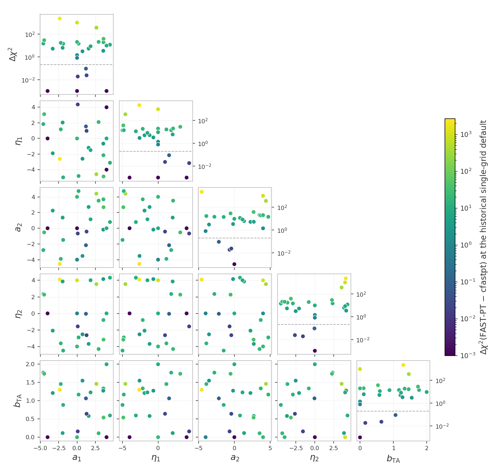
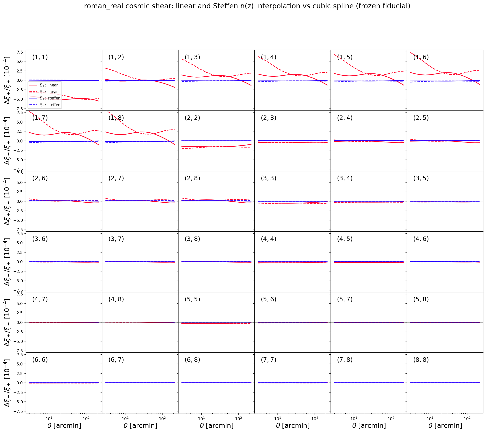

# Unit tests for the likelihoods

The frozen snapshot `frozen/` and its manifest `manifest_sha256.json`
live in the parent `tests/` directory; the paths below are relative to
it.

These tests catch two kinds of silent breakage: a $\chi^2$ that drifted
because code or data changed by accident, and a race condition (a bug
where evaluating several points in a row corrupts a later result
through leftover internal state or colliding OpenMP threads).

Every model build runs in its own worker subprocess. In this project
both examples share one data set, so the isolation is preventive: it
keeps the tests immune to the process abort that different data-set
dimensions trigger inside cosmolike, and every project keeps one
architecture. The commands below stay the same.

The mechanism of every shared check family - the frozen-reference and
race contract, the zero-baseline construction, the sweeps and their
`--high`/`--mask` options, the accuracy settings and their meanings -
is documented once in
[the shared data-vector checks](https://github.com/CosmoLike/cocoa-cosmolike-core/blob/main/README.md#dv_checks)
of the CosmoLike core. This file records what roman_real runs and what
it measured.

# Table of contents

1. [Running the tests](#run_tests)
2. [The tests](#the_tests)
    1. [The CFASTPT vs FASTPT comparison](#cfastpt_fastpt)
    2. [The Halofit vs EE2 checks](#halofit_ee2)
    3. [The EE2 race test](#ee2_race)
    4. [Scale-cut diagnostics](#scale_cut_diagnostics)
    5. [Accuracy checks](#accuracy_checks)
    6. [Baryonic feedback checks](#baryon_checks)
    7. [The photo-z convention checks](#photoz_conventions)
    8. [The non-Limber checks](#nonlimber_checks)
    9. [The sector-ladder cache check](#cache_ladder)
    10. [The halo-model checks](#halo_checks)
3. [Appendix](#appendix)
    1. [FAQ: What does this project's snapshot hold?](#frozen_copy)
    2. [FAQ: How can maintainers refresh the snapshot?](#refreeze)

## Running the tests 

We assume users are in the Conda cocoa environment from a previous
`conda activate cocoa` command, that the shell is bash, and that the
current folder is the cocoa main folder `cocoa/Cocoa`. Every command
below assumes `start_cocoa.sh` has been sourced once:

    source start_cocoa.sh

Run the full suite with

    python -m pytest ./projects/roman_real/tests/data_vector

or, without pytest,

    python -m unittest discover -s ./projects/roman_real/tests -v

The tests change no project files. Each test prints a progress line
per model build and per evaluation, then a report with the
computed $\chi^2$, the stored reference, the difference, and the pass
limit. A full run performs about 135 likelihood evaluations and takes
a few minutes. The test files force `OMP_NUM_THREADS=4` internally.

## The tests 

The standard configurations get four tests each - the frozen-reference
drift check and the race check, in NLA and in TATT
([mechanism](https://github.com/CosmoLike/cocoa-cosmolike-core/blob/main/README.md#dv_frozen)).
The TATT variants set

    IA_model: 1
    roman_A2_1: 0.05
    roman_BTA_1: 0.05
    roman_A2_2: -1.51541

The suite follows the shared
[test-file naming convention](https://github.com/CosmoLike/cocoa-cosmolike-core/blob/main/README.md#dv_naming): a file name
means the same thing in every project. This project's
configurations and test numbers:

| file | configuration | tests |
|---|---|---|
| `test_example1.py` | cosmic shear | 1-4: drift and race, in NLA then TATT |
| `test_example2.py` | 3x2pt | 5-8: drift and race, in NLA then TATT |
| `test_example2_2x2pt.py` | 2x2pt (`roman_real.combo_2x2pt`, the 3x2pt configuration reduced to galaxy clustering plus galaxy-galaxy lensing) | 11-14: drift and race, in NLA then TATT |
| `test_notebook_interface.py` | the notebook-style direct interface: EXAMPLE_EVALUATE1.ipynb's call sequence (its own CAMB run, `set_cosmology`, `compute_data_vector_masked`, no cobaya) on the frozen cosmic-shear dataset and point | 15: $\Delta\chi^2$ against the stored cobaya reference, within 0.2 |
| `test_fastpt.py` | the sweep on cosmic shear, the 3x2pt likelihood (`roman_real.combo_3x2pt`) and the 2x2pt likelihood (`roman_real.combo_2x2pt`) | 16, 17, 18 |
| `test_ee2.py` | cosmic shear, NLA with EE2 (`non_linear_emul: 1`) | 19: race, including EE2's own threaded compute |
| `test_halo_ia_race.py` | 3x2pt with Limber galaxy-galaxy lensing; halo-model IA (`include_halo_IA: 1`, Fortuna et al. 2021); runs only with `COCOA_HALO_SLOW=1` | 20: ten same-model evaluations, halo-IA tables refilled each time, bitwise identical; 21: fresh processes at 1, 4 and 8 OpenMP threads, bitwise identical |

Tests 9 and 10 are not used: the numbering follows the shared
convention, where they are the frozen FAST-PT reference checks
this project does not ship.

Test 15 exists because a changed interface binding (init_IA growing
`ia_code`) or a grid rejected by the C layer breaks every notebook
while the yaml pipeline keeps passing.

### The CFASTPT vs FASTPT comparison (`test_fastpt.py`, tests 16-18) 

The sweep mechanism, the zero-baseline construction and the
`--high`/`--mask` options are in
[the shared checks](https://github.com/CosmoLike/cocoa-cosmolike-core/blob/main/README.md#dv_fastpt).
Here, test 16 runs it on cosmic shear, test 17 on the 3x2pt likelihood
and test 18 on the 2x2pt likelihood. In test 17 the frozen
configuration fixes the one-loop bias amplitudes (`roman_B2_*`) at
zero, so the sweep scores the intrinsic-alignment tables alone on the
wider data vector; in test 18 the TATT tables are scored through
galaxy-galaxy lensing alone.

The roman_real scale-cut masks `--mask` accepts: `frozen` (the
default) keeps the frozen contract's `example1.mask` scale cuts
(1,950 of the 2,115 data points); `ones` keeps every point.

> [!NOTE]
> Before the two-grid upgrade of the fastpt theory block (2026-09)
> there was no upsampling and the difference reached
> $\Delta\chi^2 = 2248$ across the prior.

The point values, the design, and the decision record live with the
lsst_y1 project (its tests/README.md carries the full discussion);
the table below is this project's own measurement:

| output table (points) | internal grid (points) | max $\Delta\chi^2$ | Runtime / first row |
|---|---|---|---|
| 1,100 | 1,100 (shared) | 2248 | 1.00 |
| 128,900 | 1,100 | 0.187 | 1.00 |
| 1,024,900 (`accuracyboost: 1`, the default) | 1,100 (the default) | 0.0194 | 1.25 |
| 2,048,900 (`accuracyboost: 2`) | 1,300 (`internal_accuracyboost: 2`) | 0.0171 | 1.50 |

Runtime ratios use the first row of this table as the baseline, with the
same timed scope and machine. They compare sampling costs within this
project; absolute runtimes depend on the machine.

Measured on 2026-09-23:

- Test 17 (3x2pt): max $\Delta\chi^2 = 0.027$ at the defaults,
  $0.010$ at the pushed camb/cosmolike settings.
- Test 18 (2x2pt): $0.00031$ and $0.00015$, the mildest of the
  three, with the TATT tables entering through galaxy-galaxy
  lensing alone.
- `--mask=ones` (no scale cuts, all 2,115 points weighted): cosmic
  shear repeats its frozen-mask numbers digit for digit - the
  frozen `example1.mask` keeps all 1,080 cosmic-shear points, so
  the two masks agree on that section - and measures max
  $\Delta\chi^2 = 0.0076$ at the pushed settings; 2x2pt measures
  $0.0012$ at the defaults and $0.00057$ pushed.

> [!Warning]
> The 3x2pt sweep does not run under `--mask=ones`: cosmolike stops
> at `IP::set_inv_cov: masked cov not positive definite`. The shipped covariance is positive definite only under
> the frozen scale cuts - on the full 2,115-point vector its
> smallest eigenvalue is negative - so there is no all-ones 3x2pt
> measurement.

> [!NOTE]
> The fastpt defaults hold this accuracy on their own; raising the
> boosts is a convergence test, not a need. cfastpt (`IA_code: 0`)
> remains the reference implementation.

Run the comparison at the default and at the pushed camb/cosmolike
settings (the full comparison is both invocations):

    python -m pytest ./projects/roman_real/tests/data_vector/test_fastpt.py
    python -m pytest ./projects/roman_real/tests/data_vector/test_fastpt.py --high=1

### The Halofit vs EE2 checks (`test_nonlinear.py`, NL1-NL2) 

[Mechanism](https://github.com/CosmoLike/cocoa-cosmolike-core/blob/main/README.md#dv_halofit_ee2):
NL1 evaluates the cosmic-shear data vector and NL2 the 3x2pt one, each
with both nonlinear-power sources at the ten shared cosmologies
(halofit, `non_linear_emul: 2`, is the frozen contract's setting).
Measured on 2026-09-23 (the figure below, frozen mask):

- NL1 (cosmic shear): per-cosmology $\Delta\chi^2$ between 5.4 and
  253.7 (median 27.7), largest at the high-omegam draws; repeats
  its frozen-mask numbers digit for digit under `--mask=ones` - the
  frozen `example1.mask` keeps all 1,080 cosmic-shear points, so
  the two masks agree on that section.
- NL2 (3x2pt): between 65.1 and 743.3 (median 150.1); does not run
  under `--mask=ones` - cosmolike stops at
  `IP::set_inv_cov: masked cov not positive definite`, the all-ones
  covariance limitation the Warning above records for the 3x2pt
  CFASTPT sweep.
- At these ten cosmologies the two nonlinear-P(k) sources are not
  interchangeable at this project's precision, even under the
  frozen scale cuts.

Run them on their own:

    python -m pytest ./projects/roman_real/tests/data_vector/test_nonlinear.py

### The EE2 race test (`test_ee2.py`, test 19) 

[Mechanism](https://github.com/CosmoLike/cocoa-cosmolike-core/blob/main/README.md#dv_ee2):
test 19 is the race check with EE2 sourcing the nonlinear $P(k)$
(`non_linear_emul: 1`). The modification gate that compiles the
pre-modification build at test time runs as test 18 of the lsst_y1
project (its `tests/test_ee2.py`); the emulator build is
project-independent, so that comparison is not repeated here.
Measured on 2026-09-23:

- Test 19: the fresh and 10th-in-a-row fiducial agree to all eight
  printed decimals.
- The modified build against the pre-modification one, at ten
  cosmologies on this project's cosmic shear under its frozen mask:
  max $\Delta\chi^2 = 7.2\times10^{-5}$, max fractional data-vector
  difference $3.9\times10^{-5}$.

### Scale-cut diagnostics (`test_scale_cut_diagnostics.py`) 

The scale-cut diagnostics of 2011.06469 eq 17 — dlnC_ss/dlnk,
dlnxi_pm/dlnk, and the response functions rf_C_ss and rf_xi — are
notebook-facing functions with no role in the likelihood, so this
test is their only automated coverage. It checks, in one process on
the frozen TATT cosmic-shear fiducial, that every scalar and array
overload returns finite values, that the scalar overloads agree with
the matching array entries (they share the batch engines), and that
the response functions behave as normalized cumulative fractions.

The checked multipoles include $`\ell = 3`$ and 10. At $`\ell \le 20`$ an
exact scalar evaluation would underflow $`k`$ to zero in the
normalization integrand, where the C layer exits and takes a Jupyter
kernel with it; the test requires finite values there.

### Accuracy checks (`test_accuracy.py`, A1-A6) 

[Mechanism, setting meanings and cost order](https://github.com/CosmoLike/cocoa-cosmolike-core/blob/main/README.md#dv_accuracy):
the scan changes one accuracy parameter at a time on the 3x2pt NLA
configuration (each parameter's $\Delta\chi^2$ prints as a `KNOB`
line, the label the test output uses; the scan also stresses
`accuracyboost: 5` on its own); checks A1-A6 then re-evaluate cosmic
shear, 3x2pt, and 2x2pt, with NLA and TATT, with every setting raised
at once. This project's pushed values:

| setting | raised to |
|---------|-----------|
| `accuracyboost` (cosmolike) | 3 |
| `integration_accuracy` (cosmolike) | 10 |
| `internal_accuracyboost` (cosmolike) | 2 |
| `lmax` (cosmolike) | 200000 |
| `kmax_boltzmann` (cosmolike) | 40 |
| `AccuracyBoost` (CAMB) | 2 |
| `k_per_logint` (CAMB) | 50 |
| `kmax` (CAMB) | 50 |

The nested z-grid construction `accuracyboost` refines is commented in
`likelihood/_cosmolike_prototype_base.py`. The likelihood yamls set
`internal_accuracyboost: 1`, which keeps the convolution grid equal to
the output table: the exact single-grid path. Coarser grids also hold:
the lsst_y1 scan of this setting measured
$`\Delta^T C^{-1} \Delta \le 10^{-9}`$ against the single-grid path
down to `internal_accuracyboost: 0.27`.

Run them on their own, or skip them (high-accuracy evaluations take
minutes):

    python -m pytest ./projects/roman_real/tests/data_vector/test_accuracy.py
    python -m pytest ./projects/roman_real/tests --ignore ./projects/roman_real/tests/data_vector/test_accuracy.py

### Baryonic feedback checks (`test_accuracy_baryons.py` BF0-BF7, `test_baryons.py` BD1-BD7) 

[Mechanism](https://github.com/CosmoLike/cocoa-cosmolike-core/blob/main/README.md#dv_baryons):
the accuracy checks (BF) report the default-versus-pushed
$\Delta\chi^2$ with each feedback method on; check BF0 also runs the
one-setting-at-a-time scan with the Akino SP(k) feedback on, so a
large delta names the setting causing it. The drift tests (BD) pin
each method's frozen prediction. The BACCOemu point evaluates with
`omegab: 0.049`, inside that emulator's baryon-density training box,
whose floor sits exactly above the fiducial `omegab: 0.04`. Run them
with

    python -m pytest ./projects/roman_real/tests/data_vector/test_accuracy_baryons.py
    python -m pytest ./projects/roman_real/tests/data_vector/test_baryons.py

### The photo-z convention checks (`test_photoz_conventions.py`) 

[Mechanism](https://github.com/CosmoLike/cocoa-cosmolike-core/blob/main/README.md#dv_photoz):
the frozen cosmic-shear fiducial under the default, each alternative
convention, and the default again. Measured on 2026-09-24:

- default: $\chi^2 = 0.033706$ (the frozen reference exactly).
- linear: $\Delta\chi^2 = 1.6\times10^{-4}$; Steffen:
  $\Delta\chi^2 = 1.3\times10^{-6}$. Either interpolant change is far below
  the survey's statistical precision.
- Z_MID: $\Delta\chi^2 = 0.94$ - the half-bin z-column reading
  is the one photo-z convention that matters at this precision.

The figures below are regenerated by
`generate_photoz_convention_figure.py`:

### The non-Limber checks (`test_nonlimber_ggl.py`, `test_nonlimber_gg.py`) 

[Mechanism](https://github.com/CosmoLike/cocoa-cosmolike-core/blob/main/README.md#dv_nonlimber):
`adopt_limber_gs` and `adopt_limber_gg` are both `0` (non-Limber
below $\ell = 150$) in this project, because the measured differences
below are too large to absorb.

Galaxy-galaxy lensing, measured on 2026-09-27:

- $\Delta\chi^2 = 0.49$ for the 3x2pt data vector.
- The pairs with lens bin = source bin carry it: (3,3), (4,4), (2,2),
  (5,5), (1,1), (6,6) with 0.16, 0.16, 0.15, 0.14, 0.10, 0.09.

On 2026-09-28 the default switched from Limber to the exact
projection: the measured $\Delta\chi^2$ was judged too large to
absorb. The shipped data vector was regenerated with the non-Limber
default and the frozen references were refrozen from it.

Galaxy clustering, measured on 2026-09-28:

- $\Delta\chi^2 = 8.58$ for the 3x2pt data vector, against 0.49 for
  the same comparison in galaxy-galaxy lensing.
- The largest contributions are lens bins 5, 6, 4, 3 with 2.17, 2.09,
  1.74, 1.19 (each bin's block alone).

### The sector-ladder cache check (`test_cache_consistency.py`) 

The deterministic mixed-update ladder and its bitwise assertions are
described in
[the shared checks](https://github.com/CosmoLike/cocoa-cosmolike-core/blob/main/README.md#dv_cache_ladder).
In this project the ladder takes three cosmology-only steps, then
IA-only, source-photo-z and shear-calibration steps - the lenses are
the source sample, so there is no separate lens-photo-z rung - and
both intrinsic-alignment models run.

### The halo-model checks (`test_halo*.py`, `test_hod_cell.py`) 

These checks cover cosmolike's halo model: the halo mass function and
bias, concentrations and NFW profiles, the HOD galaxy power that the
likelihood key `include_HOD_GX: 1` selects, and the halo-model
intrinsic alignment of Fortuna et al. (2021) that `include_halo_IA: 1`
selects. Both keys default to 0, so the reference tests above never
reach this code.

| file | what it checks |
|---|---|
| `test_halo.py` | halo-model quantities at fixed points against `frozen/halo_reference.json` (relative tolerance $`10^{-12}`$); published fits and limits (Tinker et al. 2010 mass function and bias, Bhattacharya et al. 2013 concentrations, NFW normalization, two-halo limits); bitwise cache round trips; bitwise repeatability with 1, 4 and 8 OpenMP threads |
| `test_halo_cache_consistency.py` | the sector-ladder cache check, extended to the HOD parameters, on the HOD 3x2pt data vector |
| `test_hod_cell.py` | the HOD $`C_\ell^{gg}`$ and $`C_\ell^{gs}`$: exactly quadratic and linear in the magnification bias, a pure-magnification term equal to that of the standard calculation, a bitwise return to the standard spectra when `include_HOD_GX` goes back to 0, and the linear-bias limit at the lowest multipole |
| `test_halo_ia_cache_consistency.py` | the sector-ladder cache check on the halo-model intrinsic-alignment parameters, and a bitwise round trip of `include_halo_IA` |
| `test_halo_ia_race.py` | tests 20-21, race condition (OpenMP threading) with the halo-model intrinsic alignment: ten evaluations in a row with its tables refilled, and 1, 4 and 8 OpenMP threads, every result bitwise identical |
| `test_halo_ia_accuracy.py` | numerical convergence of the halo-model intrinsic-alignment contribution: `accuracyboost: 1` and 2 and `integration_accuracy: 1`, 2 and 3 each within $`\Delta\chi^2 = 0.02`$ of a reference at `accuracyboost: 3` and `integration_accuracy: 3`; a data vector bitwise unchanged while `include_halo_IA` is 0 |

Every file except `test_halo.py` runs only with `COCOA_HALO_SLOW=1`;
in `test_halo.py` that variable adds the slow spectrum-table checks.
The slow checks build several models and evaluate the 3x2pt data
vector dozens of times. The frozen checks of `test_halo.py` skip while
`frozen/halo_reference.json` is missing.

Run the fast halo-model checks, then every halo-model check, the slow
ones included:

    python -m pytest ./projects/roman_real/tests/data_vector/test_halo.py
    COCOA_HALO_SLOW=1 python -m pytest ./projects/roman_real/tests/data_vector/test_halo*.py ./projects/roman_real/tests/data_vector/test_hod_cell.py

## Appendix 

## :interrobang: FAQ: What does this project's snapshot hold? 

The snapshot-protection mechanism is described in
[the shared checks](https://github.com/CosmoLike/cocoa-cosmolike-core/blob/main/README.md#dv_frozen).
This project's `frozen/` holds:

| `frozen/` entry | holds |
|---|---|
| `frozen_config_*.py` | one module per configuration (cosmic shear, 3x2pt, and 2x2pt): the complete cobaya configuration as a yaml string, plus the exact evaluation point |
| `data/` | the tests' own copy of the data vectors, covariance, n(z), and masks |
| `reference_chi2.json` | the six reference $`\chi^2`$ values: cosmic shear, 3x2pt, and 2x2pt, each with NLA and TATT |
| `halo_reference.json` | the halo-model values `test_halo.py` compares against |
| `EXAMPLE_EVALUATE{1,2}.yaml` | snapshots kept only so a human can diff how the live examples drifted since the freeze |

All TATT variants evaluate against `frozen/data/tatt_roman_real.dataset`,
the synthetic vector generated at freeze time
([why](https://github.com/CosmoLike/cocoa-cosmolike-core/blob/main/README.md#dv_frozen)).

## :interrobang: FAQ: How can maintainers refresh the snapshot? 

A deliberate change to the data vectors, n(z), covariance, examples,
or likelihood defaults requires a re-freeze. The `_meta` block of
`frozen/reference_chi2.json` records when the current references were
generated.

We assume users are in the Conda cocoa environment from a previous
`conda activate cocoa` command, that the shell is bash, and that the
current folder is the cocoa main folder `cocoa/Cocoa`.

**Step :one:**: activate the private Python environment by sourcing
the script `start_cocoa.sh`

    source start_cocoa.sh

**Step :two:**: rebuild the snapshot

    python ./projects/roman_real/tests/generate_frozen_reference.py --overwrite

**Step :three:**: add the feedback vectors of the drift tests

    python ./projects/roman_real/tests/generate_frozen_reference.py --baryons

The first command deletes and rebuilds `frozen/` from the current
project, including the halo-model values of `test_halo.py`, prints the
six new reference $\chi^2$ values, and rewrites the manifest. It does not
write the per-method feedback vectors of `test_baryons.py`; the second
command adds them and rewrites the manifest again. Review the printed
$\chi^2$ values against the old references before committing: they define
what every later test run compares against.

> [!NOTE]
> `--halo`: rewrite only `frozen/halo_reference.json` in an existing
> snapshot, and the manifest with it.
